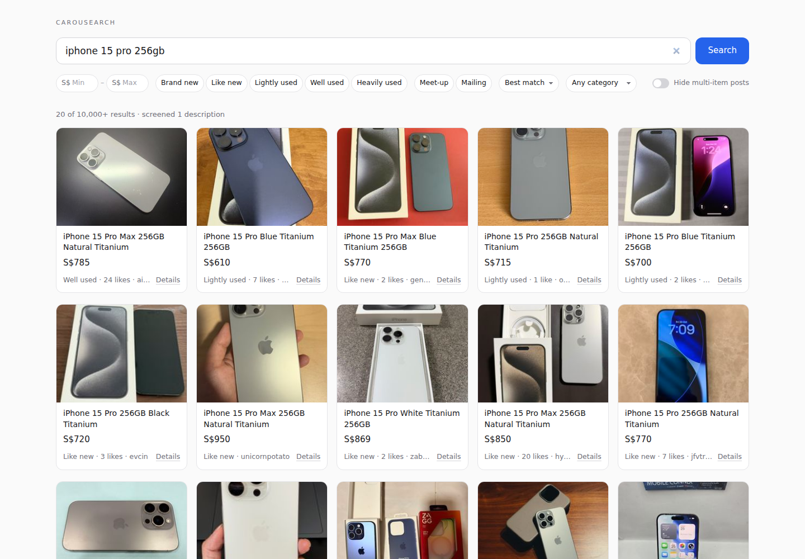

# carousearch

Carousearch is a planned personal Telegram bot for searching [Carousell Singapore](https://www.carousell.sg) in plain English. A cheap LLM turns a prompt like "lightly used Aeron chair under $600, meet-up near Tampines, newest first" into Carousell's own search filters (Level 1). It then fills the search keywords and category-specific fields such as phone model, storage or shoe size (Level 2). Finally it screens the listings it finds: plain rules for seller rating, account age, price outliers and keyword blocklists, plus a vision model for subjective calls like low-effort photos or reseller-template descriptions (Level 3). It ranks results and shows them in Telegram with editable filter buttons. **Phase 1 is built** (2026-10-24): a tested Python client and command line for structured Carousell searches, listing details and a breakage canary. **Phase 2 task 1** adds a single-user Telegram bot that builds a search one question at a time with buttons (see [Running the Telegram bot](#running-the-telegram-bot)). **Phase 3a** adds [screening](#screening) for multi-item "catalogue" posts, with optional Claude Haiku price lookup; prompt-to-filters has no LLM yet. **Phase 3b** adds a local [web app](#web-app) for searching with filters and reading screened results in a card grid; the Telegram bot stays for quick lookups and future alerts. An [MCP server](#mcp-server) lets agent hosts such as Claude Code search Carousell through the same client. **Phase B** adds [`carousearch ask`](#ask-the-agent): carousearch's own agent, which answers a plain-English shopping prompt by calling that server's tools with a model of your choice (Claude Haiku by default).

- [docs/FEASIBILITY.md](docs/FEASIBILITY.md): full feasibility study: verdict, recommended stack, costs, risks, architecture
- [docs/CAROUSELL_ACCESS_NOTES.md](docs/CAROUSELL_ACCESS_NOTES.md): raw technical findings on Carousell's endpoints, filters, response shapes and anti-bot behaviour
- [docs/ROADMAP.md](docs/ROADMAP.md): Levels 1 to 3 as milestones with tasks, acceptance criteria and effort estimates (and the phase 1 status)
- [docs/MCP.md](docs/MCP.md): the MCP server for agent hosts: its tools, registering it with Claude Code, Codex CLI, the Claude desktop app and ChatGPT, example prompts and the request budget
- [docs/ANALYSIS_AND_SCREENING_PLAN.md](docs/ANALYSIS_AND_SCREENING_PLAN.md): implementation spec for market analysis (fresh pulls, upsert-by-content-hash storage, plan → scrape → compute → summarise), read-only SQL questions, and the staged screening pipeline with auditable vision verdicts; supersedes the roadmap's Level 3

## Layout

```
src/carousearch/
  filters/schema.py      SearchRequest, Listing, ListingDetail, SearchResult (the shared data model)
  filters/payload.py     SearchRequest -> exact JSON body for Carousell's search endpoint (all Carousell codes live here)
  carousell/client.py    CarousellClient: session bootstrap, CSRF, re-bootstrap, rate limiting (all network I/O)
  carousell/parse.py     pure functions: response JSON / HTML -> models, block detection
  carousell/rate_limit.py, carousell/errors.py
  photos.py              downsize a listing photo to a maximum width (Pillow, pure)
  storage.py             SQLite: seen_listings, listing_detail_cache, saved_searches, listings (upsert by content hash),
                         listing_changes, harvest_runs
  market/hashing.py      content hash of a listing, hash of a search request (pure)
  market/limits.py       HarvestLimits (pages, age cutoff, page size)
  market/harvest.py      walks a search's pages into `listings` and records the run; reuses a recent identical run
  market/analysis.py     AnalysisSpec and the price statistics (pure)
  market/render.py       analysis result as text / JSON (pure)
  screening/models.py    Tag, ResolvedPrice, ScreenedListing (the contract for --json and the web front end)
  screening/rules.py     title, description and price rules, and dollar-amount extraction (pure)
  screening/price_resolver.py  PriceResolver: Claude (Anthropic API) or Noop; prompt and parsing are pure
  screening/store.py     detail and resolved-price caches behind a small interface (SQLite)
  screening/pipeline.py  screen_listings: rules, budgeted detail fetches, price resolution (I/O injected)
  config.py              data folder, the Telegram settings and the optional ANTHROPIC_API_KEY (environment or .env)
  bot/state.py           SearchSession, the wizard stages and their transitions, button actions and
                         their callback_data encoding (pure)
  bot/price_input.py     typed price ranges ("150-400", "<250", ">1000") to and from text (pure)
  bot/keyboard.py        each stage's inline keyboard, the "Step n/6" header and recap (pure)
  bot/messages.py        help, step questions, request summary, lock reminder, captions, error texts (pure)
  bot/session_store.py   the active session for each chat, with 30-minute idle expiry (in memory)
  bot/handlers.py        python-telegram-bot handlers, BotServices, owner check (Telegram and Carousell I/O)
  bot/app.py             builds the Application, runs polling, and the `whoami` helper
  web/app.py             create_app(settings): FastAPI app, services built once at startup, static files
  web/routes.py          the page (/), the results partial (/results) and the detail partial (/listing/{id})
  web/query_params.py    URL query string <-> SearchRequest, Load-more counts (pure)
  web/view_models.py     price row, badges, meta line, results line, form and detail views (pure)
  web/services.py        WebServices; the screened search and listing detail (blocking, run one at a time)
  web/templates/, web/static/  Jinja2 templates; app.css, app.js, htmx.min.js (2.0.11, vendored)
  mcp_server.py          build_server(services): the MCP tools (search, details, photo, screening tags, usage notes)
  mcp_instructions.md    the usage notes the MCP server sends to hosts
  agent/settings.py      AGENT_MODEL, the per-run budgets and the provider API keys (environment or .env)
  agent/prompt.py        the agent's system prompt
  agent/result.py        AgentAnswer: kept, dropped, notes and tool_trace (the contract for `ask --json`)
  agent/budget.py        ToolBudget: counts a run's tool calls, photos and listings against the caps (pure)
  agent/trace.py         the tool trace, from a run's message history (pure)
  agent/run_prompt.py    run_prompt: a Pydantic AI agent over the in-process MCP server, with the budget hook
  canary.py              the health check behind `carousearch canary`
  fixture_capture.py     the dev command behind `carousearch capture-fixtures`
  text_render.py, cli.py terminal output and the `carousearch` command
tests/                   pytest; fixtures/ holds trimmed real responses captured 2026-10-24
```

## Setup

Python 3.12 or newer.

```bash
cd ~/carousearch
python3 -m venv .venv            # Debian/Ubuntu needs the python3.X-venv apt package for this
.venv/bin/pip install -e ".[dev]"
.venv/bin/pip install -e ".[llm]"   # optional: the anthropic SDK, for screening's price lookup
```

If `python3 -m venv` fails with "ensurepip is not available" (the case on this machine), create the venv with [uv](https://docs.astral.sh/uv/) instead:

```bash
uv venv --python 3.14 .venv
uv pip install --python .venv/bin/python pip -e ".[dev,llm]"   # llm is optional
```

Runtime data goes to `~/carousearch/data/` (`carousearch.db`, `canary.log`). Override with `--data-dir` or the `CAROUSEARCH_DATA_DIR` environment variable.

## Commands

Every command makes one bootstrap request (the home page, for cookies and the CSRF token) plus its own calls, at least 1.0 s apart with ±0.3 s jitter (`--min-interval`, `--jitter`).

### search

```
$ carousearch search "iphone 15" --price-max 900 --condition used --limit 10
ID          PRICE      CONDITION     LIKES  TITLE                                         SELLER              URL
1469923094  S$579      Like new      1      iPhone 15 256GB Blue                          urameshi1984        https://www.carousell.sg/p/1469923094/
1463757293  S$750      Lightly used  3      iPhone 15 Pro 128GB Natural Titanium          grandstone.022d1e   https://www.carousell.sg/p/1463757293/
1469915662  S$650      Like new      1      iPhone 15 Pro 128GB Natural Titanium          invalidcode         https://www.carousell.sg/p/1469915662/
...
Showing 10 of 1,000+ results; more pages available (use --json to get next_page).
```

Options:

| Option | Meaning |
|---|---|
| `--price-min`, `--price-max` | SGD |
| `--condition` | comma-separated `brand_new`, `like_new`, `lightly_used`, `well_used`, `heavily_used`, or the groups `new` / `used` (`used` = the four used levels) |
| `--sort` | `best_match` (default), `recent`, `price_low_to_high`, `price_high_to_low`, `nearby` (needs a location filter, not in phase 1) |
| `--deal-method` | comma-separated `meetup`, `mailing` |
| `--buyer-protection`, `--free-delivery` | only listings with Buyer Protection / free delivery |
| `--category` | Carousell collection **id**, e.g. `5707` Mobile Phones, `5755` Chairs, `1793` Laptops (ids in the access notes, section 4.8) |
| `--field KEY=VALUE` | category facet, repeatable; repeat a key for several values, e.g. `--field mobile_storage=MOBILE_STORAGE_256_GB` |
| `--limit` | page size, 1 to 48 (default 20) |
| `--json` | print `{listings, total, total_display, next_page}` as JSON |
| `--page-cursor` | the `next_page` value from a previous `--json` run, to fetch the next page |
| `--screen` | tag multi-item posts and add the YOUR PRICE and FLAGS columns ([Screening](#screening)) |
| `--hide-multi-item` | leave multi-item posts out (implies `--screen`) |
| `--max-detail-fetches` | with `--screen`: Carousell detail requests to make at most (default 10) |

Example with a category facet:

```bash
carousearch search "iphone 15 pro" --category 5707 --field mobile_storage=MOBILE_STORAGE_256_GB --deal-method meetup --sort recent
```

Listings shown are recorded in the `seen_listings` table.

## Screening

Carousell "catalogue" posts advertise many variants in one listing ("iPhone 15 / 15 Pro / 15 Pro Max all storage") and show one price, usually the cheapest variant's. `carousearch search ... --screen` tags such posts and, where the description has a price list, looks up the price of the variant you searched for.

```
$ carousearch search "iphone 15 pro 256gb" --price-max 1200 --limit 20 --screen
ID          PRICE      YOUR PRICE    FLAGS                               CONDITION     LIKES  TITLE ...
1470223613  S$610      S$610         -                                   Lightly used  6      iPhone 15 Pro Blue Titanium 256GB
1470142763  S$8.88     S$8.88        Below market                        Lightly used  1      iPhone 15 Pro 256GB Black Titanium
...
Screening: 0 of 20 multi-item; 1 description checked (detail budget 10); price resolution off (ANTHROPIC_API_KEY not set), so YOUR PRICE is the listed price.
```

Tags (`code`, label, severity). Each tag also carries a one-sentence `reason` with the evidence, e.g. "title names 3 variants: iPhone 15, 15 Pro, 15 Pro Max; says 'all storage'":

| Code | Label | Severity | When |
|---|---|---|---|
| `MULTI_ITEM_TITLE` | Multi-item title | warn | the title names 2+ distinct models ("15 / 15 Pro"), 2+ storage sizes ("128GB/256GB"), or says "all models", "all storage", "many sets", "from $..." |
| `PRICE_LIST_IN_DESCRIPTION` | Price list | warn | the description offers 3+ distinct prices, or has 2+ lines like "15 Pro 256GB - $850" |
| `LISTED_PRICE_IS_FLOOR` | Floor price | warn | the listed price is the lowest of 2+ prices in the description, or the description says "from $..." |
| `PRICE_BELOW_MARKET` | Below market | info | the price is under 60% of the median of the other results on the page (needs 5+ others) |
| `PRICE_NOT_FOR_YOUR_ITEM` | Price not for your item | warn | the price lookup read the description and found no price for your variant |

A listing with any warn tag is multi-item (`is_multi_item`). Reference prices ("bought at $1,299", "retail $1,599") are not counted as offered prices; storage sizes, percentages, durations, years and Singapore phone numbers are never read as prices.

How it runs, per page of results:

1. The title rule and the below-market rule run on every listing; they need no requests.
2. Listings tagged in step 1 get their listing detail, through the 12-hour detail cache, for at most `--max-detail-fetches` (default 10) Carousell requests per search, so a page of 20 to 48 results never costs more than 10 extra requests. Then the description rules run.
3. Listings that are multi-item after step 2 go to the price resolver, through `price_resolution_cache` (keyed by listing id and search keywords, so a listing is never looked up twice for the same search).

**Price lookup (optional).** Put an Anthropic API key in `.env` (`ANTHROPIC_API_KEY=...`, see `.env.example`) and install the `llm` extra. Screening then asks Claude Haiku 5.5 (`claude-haiku-5-5`, structured JSON output, thinking off, `max_tokens` 256) for the price the description states for exactly your search; it answers `not_stated` rather than guess, which adds the "Price not for your item" tag. Descriptions are cut to 1,500 characters. Without a key, multi-item posts keep their listed price and the summary line says so.

Cost estimate per looked-up listing (from character counts; no call has been made yet): about 750 input tokens for a typical description and up to about 1,300 for a 1,500-character one (system prompt and schema about 500, the listing up to about 550, plus the structured-output overhead), and 30 to 80 output tokens. At US$0.10 per million input and US$0.50 per million output tokens that is US$0.0001 to US$0.0002 per listing, so US$1 covers roughly 5,000 to 10,000 lookups. Only multi-item listings with a fetched description are looked up, and cached answers are free.

`--json` prints `{screened_listings, total, total_display, next_page}`; each item has `listing`, `detail` (when the description was checked), `tags`, `resolved_price` (`amount`, `source`: `listed` / `description` / `not_stated`, `note`) and `is_multi_item`. In Telegram, result cards of multi-item posts get the one-line summary from the title rule only (no extra requests), e.g. "Multi-item · listed S$579 · may not be your variant's price".

### listing

```
$ carousearch listing 1463757293
iPhone 15 Pro 128GB Natural Titanium
S$750  |  Lightly used  |  3 likes
https://www.carousell.sg/p/1463757293/

Seller:         grandstone.022d1e (id 37448921)
Rating:         5.00 / 5 from 3 reviews
Joined:         2022-08-30
Response rate:  H
Verified:       email, mobile, Google
Created:        2026-09-24 10:15 SGT
Last modified:  2026-10-24 00:59 SGT
Deal:           meet-up yes, mailing no
Meet-up points: HarbourFront Centre, 1 Maritime Sq., 099253
Photos:         2
  https://media.karousell.com/media/photos/products/2026/9/24/iphone_15_pro_128gb_natural_ti_1790216103_80c8500c.jpg
  ...

Description:
  This is my backup phone for my US number. ...
```

`--json` prints the full `ListingDetail`, including the `raw` listing object from Carousell. The detail is also stored in `listing_detail_cache`.

### harvest

Pulls every page of one search (up to `--max-pages`, default 10, 48 listings a page) into the `listings` table, one row per listing, and records the run in `harvest_runs` so an analysis can read exactly what that pull returned. Takes the same filter options as `search`.

```
$ carousearch harvest "iphone 15 pro" --category 5707 --condition used --sort recent --max-pages 5
run 12: 212 listings, 5 pages, stopped: max_pages (37 new, 4 changed)
```

A listing already in the table is overwritten only when its title, price or condition changed (a content hash decides); that change is also appended to `listing_changes` with the old and new price. Likes, the bump time and `last_seen_at` are refreshed on every pull. An identical search run in the last 30 minutes is reused instead of scraped again (`reused run 11: …`) when that run covered at least as much (it exhausted the pages, or fetched at least as many pages, or used the same or a longer age cutoff); pass `--no-reuse` to force a fresh pull. `--max-age-days N` stops once listings get older than N days and needs `--sort recent`.

### analyze

Runs the searches in an analysis spec, then prints price statistics for the union of their listings: count, min, p25, median, p75 and max, overall and per group (the mean is in the `--json` output), with IQR outliers listed separately and excluded by default. The spec is JSON ([docs/examples/analysis_spec.example.json](docs/examples/analysis_spec.example.json)):

```json
{
  "question": "What do used iPhone 15 Pro 256GB listings go for, by condition?",
  "searches": [{"query": "iphone 15 pro 256gb", "category": "5707", "sort": "recent"}],
  "limits": {"max_pages": 5, "max_age_days": 30},
  "title_filter": {"include": ["15 ?pro"], "exclude": ["pro ?max", "case"]},
  "group_by": "condition"
}
```

```
$ carousearch analyze --spec docs/examples/analysis_spec.example.json
run 12: 212 listings, 5 pages, stopped: max_pages (37 new, 4 changed)
What do used iPhone 15 Pro 256GB listings go for, by condition?
Fetched 212 listings (1 run); analysed 184 (14 without a price, 9 filtered out, 5 outliers excluded)
All           n=184  median S$1,050  p25–p75 S$980–S$1,150  min S$700  max S$1,400
...
```

`group_by` is `none`, `condition`, `week_posted` (ISO weeks in Singapore time) or `seller`; `title_filter` holds case-insensitive regexes (every `include` must match, no `exclude` may). `--json` prints the full result; `--spec -` reads the spec from stdin. The statistics are asking prices, not sold prices.

### canary

Runs a fixed search for "iphone" (20 per page), checks that at least 10 listings parse (`--min-listings`), then fetches and parses the first listing's detail. Prints one line, appends it to `~/carousearch/data/canary.log` (`--log-file` to change), and exits 0 on success or 1 on failure.

```
$ carousearch canary; echo "exit code: $?"
2026-10-24T01:38:12+08:00 OK 20 listings parsed, detail 1451884114 parsed (2.2s)
exit code: 0
```

A failure looks like `... FAIL search failed: CarousellBlockedError: Cloudflare challenge (HTTP 403, cf-mitigated: challenge) (1.3s)`.

### capture-fixtures (developer command)

Run from the project root. Re-fetches the fixture set (bootstrap page, two searches, one listing detail, one deliberately provoked Cloudflare challenge; 5 requests) and overwrites the files in `tests/fixtures/`.

```
$ carousearch capture-fixtures
wrote tests/fixtures/bootstrap_page.html (1,205 bytes)
wrote tests/fixtures/search_price_condition.json (24,123 bytes)
...
wrote tests/fixtures/cloudflare_challenge.json (5,683 bytes)
```

## Tests

```bash
.venv/bin/pytest           # unit tests, offline, driven by tests/fixtures/ (live test deselected)
.venv/bin/pytest -m live   # one integration test against the real carousell.sg (about 4 requests)
.venv/bin/ruff check src tests
```

## Daily canary with cron (WSL2)

Add this with `crontab -e` (08:00 every day):

```
0 8 * * * /home/moses/carousearch/.venv/bin/carousearch canary >> /home/moses/carousearch/data/cron.log 2>&1
```

WSL2 does not start cron by itself. Either:

- enable systemd in WSL (`/etc/wsl.conf`: `[boot]` then `systemd=true`, run `wsl --shutdown` from Windows) and then `sudo systemctl enable --now cron`; or
- start it after each WSL boot with `sudo service cron start`; or
- skip cron and create a Windows Task Scheduler task that runs
  `wsl.exe -d <your distro> -u moses -- /home/moses/carousearch/.venv/bin/carousearch canary`
  daily. This also works when no WSL session is open.

The canary's own log is `~/carousearch/data/canary.log`; `cron.log` only catches crashes.

## Web app

A one-page web app for searching Carousell with filters and spotting catalogue posts whose shown price may not be the price of what you searched for. It runs on this machine only, without a login.

```bash
.venv/bin/carousearch web              # then open http://localhost:8765
.venv/bin/carousearch web --port 9000  # another port; --host 127.0.0.1 is the default
```

On WSL2, open http://localhost:8765 in the Windows browser (WSL forwards localhost). Ctrl+C stops the server. It can run next to the Telegram bot: both use `~/carousearch/data/carousearch.db`, and each has its own Carousell session and rate limiter. The bot stays the tool for quick lookups from your phone and for the alerts planned later.



The controls (all optional; after the first search, changing any of them searches again):

| Control | What it does |
|---|---|
| Search box | Keywords. Enter or **Search** runs the search; after that, a pause in typing (0.6 s) re-runs it. |
| S$ Min, S$ Max | Price range in SGD. `1,200` and `S$1,200` work; anything else is ignored, and a reversed range is swapped. |
| Condition chips | Brand new, Like new, Lightly used, Well used, Heavily used. Select any number; none means any condition. |
| Delivery chips | Meet-up, Mailing. None means either. |
| Sort | Best match, Recent, Price ↑ (low to high), Price ↓ (high to low). |
| Category | Any, or one of the common categories (Mobile Phones, Laptops, Tablets, Furniture, Video Gaming, Audio). A URL with any other collection id, e.g. `category=5755`, also works. |
| Hide multi-item posts | Leaves out listings that screening flags as multi-item; the results line says how many were hidden. |

The address bar follows the search (`/?q=iphone+15+pro&price_max=1200&condition=like_new`), so a search can be bookmarked and Back and Forward step through earlier searches.

Each card shows the photo, the title, the price row, then condition · likes · seller. The whole card opens the listing on Carousell in a new tab. **Details** opens a panel under the card's row with the full description, all photos, the seller's rating, reviews, joined date and response rate, the meet-up points, and every screening tag with its reason; click **Details** again or **Close** to fold it.

The price row:

| You see | Meaning |
|---|---|
| S$720 | The listed price. Nothing suggests it is wrong. |
| **S$850** ~~S$579~~ *from description* | A catalogue post: the description gives S$850 for the item you searched for, while the card shows S$579 (usually the cheapest variant). Needs `ANTHROPIC_API_KEY` ([Screening](#screening)). |
| S$579 *price for your item not stated* | The description was read and has no price for the item you searched for, so the listed price probably belongs to another variant. |

Badges on the photo: **Multi-item** (amber) means a screening rule thinks the price does not apply to your item; hover over it for the reasons. **Low price** (grey) means the price is under 60% of the median of the other results on the page (often a placeholder such as S$1 or S$8.88).

The line above the grid reads like `20 of 10,000+ results · 3 multi-item hidden · screened 6 descriptions`. "Screened" counts listings whose description was checked; "price lookup off" appears when there are multi-item posts but no `ANTHROPIC_API_KEY`, so their listed price is kept. **Load more** at the bottom appends the next page.

Keyboard: `/` puts the cursor in the search box from anywhere on the page; Esc leaves a field.

Requests: a search costs one Carousell search plus, for flagged listings, up to 10 detail requests (cached for 12 hours, shared with the CLI and the bot), all through one rate limiter and one call at a time. The same search again within 2 minutes (toggling the switch, going Back) is answered from memory, and a search the browser has already replaced is skipped. If Carousell blocks the client the page says "Carousell is rate-limiting us, try again in a minute"; if its response changed shape it says to run `carousearch canary` (see [When Carousell changes](#when-carousell-changes)). Details of any error go to the terminal running `carousearch web`, never to the page.

## MCP server

`carousearch mcp` lets an agent host (Claude Code, Codex CLI, the Claude desktop app, or ChatGPT through a tunnel) search Carousell through this client: `search_listings`, `listing_details` (12-hour cache), `listing_photo` (downsized, Carousell's media host only), the optional `screening_tags`, and `usage_notes`. It is only a connector: the host filters, ranks, looks at photos and plans; the server does none of that. Over stdio by default; `--transport http --port 8766` serves streamable HTTP on 127.0.0.1 for tunnelling.

```bash
claude mcp add --scope user carousearch -- /home/moses/carousearch/.venv/bin/carousearch mcp
```

[docs/MCP.md](docs/MCP.md) has the setup for every host, example prompts and the request budget (about 40 Carousell requests per task).

## Ask the agent

`carousearch ask` answers a shopping prompt in plain English. It runs an agent built with [Pydantic AI](https://pydantic.dev/docs/ai/) whose tools are the [MCP server](#mcp-server)'s five tools, nothing else. The server runs inside the same process, so a run starts no second interpreter. The agent searches first, filters the results itself, fetches details for a shortlist only and looks at photos last, then reports what it kept, everything it dropped with the reason, and notes.

```bash
.venv/bin/carousearch ask "Find Nintendo Switch consoles under S\$200 with meet-up. Drop listings whose title mentions more than one console model. For the top 3 by likes, look at the main photo and say whether it looks like a real used unit or a stock/catalogue image."
.venv/bin/carousearch ask "used Aeron chair under S\$600, meet-up" --json         # the answer as AgentAnswer JSON
.venv/bin/carousearch ask "road bike under S\$800" --model openai:gpt-5 --max-photos 5
```

It needs the API key of the model's provider: `ANTHROPIC_API_KEY` for the default `anthropic:claude-haiku-5-5`, `OPENAI_API_KEY` for an `openai:` model, in `.env` or the environment. Without it, `ask` exits with an error before making any request.

The output, top to bottom:

- **Tool calls**: one line per call, with its duration, the tool and its arguments, and `[refused]` (over a budget, never sent to Carousell), `[failed]` (the tool reported an error, such as Carousell blocking) or `[not run]` when it did not run normally.
- **Kept**: a table of price, title, seller, URL and the agent's one-line reason. The reason comes last so it is never cut off.
- **Dropped**: every listing the agent saw and excluded, each with its reason.
- **Notes**: the agent's assumptions and what you should check yourself, plus a line for each budget that stopped or shortened the run.

`--json` prints the same as one `AgentAnswer` object: `kept` (`listing_id`, `title`, `price`, `url`, `seller`, `reason`), `dropped` (`listing_id`, `title`, `reason`), `notes` and `tool_trace` (`tool_name`, `arguments`, `duration_seconds`, `status`).

| Setting (`.env` or environment) | Default | Meaning |
|---|---|---|
| `AGENT_MODEL` | `anthropic:claude-haiku-5-5` | Any Pydantic AI model string, `provider:model`. `--model` overrides it. |
| `AGENT_MAX_TOOL_CALLS` | 40 | Tool calls per run: search pages, details, photos and tags together. |
| `AGENT_MAX_PHOTOS` | 15 | Photos the agent may look at. `--max-photos` overrides it. |
| `AGENT_MAX_LISTINGS` | 200 | Listings asked for across all search pages. A page that would pass it is cut short. |

The budgets are enforced, not advised. A call over a budget is refused before it reaches Carousell, and the agent is told to finish with what it has. The notes then say which budget was reached. A model that keeps calling tools anyway is stopped after its tool-call budget plus 5 more model requests. Carousell requests still go through the usual rate limiter (1.0 s ± 0.3 s apart), so a run with 20 tool calls takes at least 20 seconds plus the model's time. Details come from the 12-hour cache shared with the other commands.

Photos reach the model as images: Anthropic models and OpenAI's Responses API get them inside the tool result, and OpenAI chat models get them in a separate user message (Pydantic AI chooses). Cost with Claude Haiku 5.5 (US$0.10 per million input tokens, US$0.50 per million output tokens) should be a few US cents per run. That is an estimate, not yet measured against the real API.

## Running the Telegram bot

The bot answers one Telegram user (you). Send it keywords and it asks for the filters one at a time with buttons, shows a summary, and on **Search** replies with listing cards (photo, price, condition, likes, title, seller, link), 5 at a time.

### 1. Create the bot in BotFather

In Telegram, open a chat with [@BotFather](https://t.me/BotFather) and send `/newbot`. Pick a display name, then a username that ends in `bot` (for example `moses_carousearch_bot`). BotFather replies with a token like `1234567890:AAH...`. Keep it secret: anyone with the token can control the bot.

Optional: send BotFather `/setcommands`, pick the bot, and paste:

```
search - start a search (optionally with keywords)
status - where the current search is
end - finish the current search
saved - list saved searches
save - save the current search under a name
help - how to use the bot
```

### 2. Create `.env`

```bash
cd ~/carousearch
cp .env.example .env
```

Put the token into `.env`. Then find your numeric Telegram user id, either by messaging [@userinfobot](https://t.me/userinfobot), or by sending `/start` to your new bot and running:

```
$ .venv/bin/carousearch whoami
User id     Name (people who messaged the bot in the last 24 hours)
123456789  Moses (@moses)
```

`.env` then looks like this (`.env` is in `.gitignore`; environment variables of the same name override it):

```
TELEGRAM_BOT_TOKEN=1234567890:AAH...
TELEGRAM_OWNER_ID=123456789
```

### 3. Run it

```bash
.venv/bin/carousearch bot
```

It logs to the console: start-up, every Carousell search and detail call, refused users (with their user id, which helps if you mistyped yours) and any handler error. Ctrl+C stops it. Without a token or owner id it exits with code 2 and says which setting is missing.

In Telegram:

- send keywords (or `/search <keywords>`) to start a search. `/search` on its own first asks "What are you looking for?".
- the bot then asks one thing per step, editing the same message as you tap: **Step 2/6 Price** (`< 100`, `100–300`, `300–800`, `800+`, Any, or **Type a range** such as `150-400`, `<250`, `>1000`), **3/6 Condition** and **4/6 Delivery** (tick any number, then Next), **5/6 Sort**, **6/6 Category** (common ones, Any, or **Other id…** to type a collection id such as `5707`). The header recaps what you have picked so far. Every step has **Back** and **Cancel**.
- the **Summary** lists every filter, with **Search** and an **Edit** button per step; an edited step returns straight to the summary.
- **Search** sends 5 cards, then a message with **Next 5**, **Refine** (back to the summary with the same filters) and **End**. Listings you have been shown before (in the bot or by `carousearch search`) get a `[seen]` tag. **Details** on a card shows the seller, rating, description and photo links (cached for 12 hours).
- one search at a time: while one is in progress, `/search` and new keywords get a reminder to `/end` it (or use Back / Refine). `/status` shows where it is; a search idle for 30 minutes expires and the next one starts fresh. Only the buttons on the newest message of the search work.
- `/save <name>` saves the current filters; `/saved` lists them with buttons to load one (at the summary step, when no search is in progress).

Only one copy of the bot can run at a time (Telegram answers a second poller with "Conflict").

### 4. Keep it running on WSL2

The simplest way is `nohup` from a WSL terminal:

```bash
nohup /home/moses/carousearch/.venv/bin/carousearch bot >> /home/moses/carousearch/data/bot.log 2>&1 &
tail -f /home/moses/carousearch/data/bot.log      # watch it
pkill -f "carousearch bot"                        # stop it
```

This stops when WSL shuts down (a Windows restart, `wsl --shutdown`, or WSL stopping the distro when no terminal has been open for a while). For something that survives that, replace it later with a systemd user service (with systemd enabled in `/etc/wsl.conf`, as in the cron section above) or a Windows Task Scheduler task that runs `wsl.exe -d <your distro> -u moses -- /home/moses/carousearch/.venv/bin/carousearch bot` at logon.

## When Carousell changes

Carousell's `/ds/` endpoints are undocumented and can change without notice. When `carousearch canary` fails, its one-line reason tells you which case you are in:

- **`CarousellBlockedError`** (Cloudflare challenge, captcha, HTTP 429, or 401/403 after a fresh session): Carousell is screening the client. Check that https://www.carousell.sg loads in a normal browser from the same network, lower the request rate, and wait. Updating `BROWSER_USER_AGENT` in `carousell/client.py` to a current Chrome version can help. The HTML and Playwright fallbacks are not built yet (see the TODO in `CarousellClient.search` and the roadmap).
- **`CarousellSchemaError: missing key '...'`**: the response shape changed. From the project root run `carousearch capture-fixtures`, then `pytest`. The failing parser tests and the error message point at the key that moved. Compare the new fixture with the shapes in `docs/CAROUSELL_ACCESS_NOTES.md` section 4, update `carousell/parse.py`, and record the change in the notes.
- **`CarousellHTTPError`** (404, 5xx, network error): a 404 usually means an endpoint path moved. Open carousell.sg in a browser with the developer tools Network tab, run a search, and look for the new `/ds/...` request; update the paths in `carousell/client.py`.
